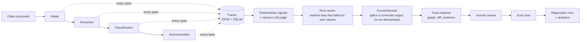

# Failure Forensics Tool

When a multi-step AI pipeline gives a wrong answer, the step where you *notice* the error
is rarely the step that *caused* it. This tool traces every step of a pipeline, works out
which step broke first, **proves it** by re-running the pipeline from a corrected step, and
turns each confirmed failure into a regression test.

It's a scoped-down LangSmith/Braintrust: tracing, root-cause analysis, a visual trace
explorer, and a feedback-to-eval loop, built around a 4-step insurance-claims pipeline
running on a local 3B model.

---

## One real failure, end to end

From the tool's own output on corpus document `doc_005`, a home burglary reported by
Nadia Osei:

| Step | What happened | Tool's verdict |
|---|---|---|
| **Intake** | Stripped the subject line and sign-off as "boilerplate". They were the only places the claimant's name appeared. | **Root cause**: Context Loss |
| **Extraction** | With no name in its input, invented `claimant_name: "John Doe"`. | Also failed on its own: Extraction Hallucination |
| **Classification** | Called a burglary of jewellery, a laptop and bicycles an **auto** claim. | Also failed on its own: Misclassification |
| **Summarization** | Faithfully wrote "John Doe reports the theft of his vehicle". | Propagation: it did its job with what it was given |

Extraction had the **biggest** quality drop (0.20 local quality against intake's 0.62), so
a "blame the worst step" heuristic would have named it. The tool named intake, because
extraction's fault only exists *because of* intake's. A counterfactual re-run from a
corrected intake raised the final summary's fidelity from 0.78 to 0.89 (verdict PARTIAL).

A reviewer confirmed the diagnosis, and it became an eval case: *"intake's output must
keep 'Nadia Osei'"*. One line added to the intake prompt flipped that case from
**failing** to **fixed** in the regression matrix. Another open case (doc_009, an
extraction error) stayed failing, as it should.

---

## How it works



| Phase | What's built | Where |
|---|---|---|
| 1. Pipeline | Four typed steps (Pydantic in and out), grammar-constrained output, bounded repair loop, content-addressed replay cache | `ffx/pipeline/`, `ffx/llm/` |
| 2. Tracing | Trace and span per step: input, prompt, raw response, every repair attempt, tokens, latency, self-reported confidence. Optional OpenTelemetry export. | `ffx/tracing/` |
| 3. Diagnosis | Deterministic signals, a failure taxonomy, root-cause ranking, an LLM judge for genuine ambiguities, counterfactual verification, an evidence chain | `ffx/analyzer/` |
| 4. Explorer | FastAPI and React Flow: a node graph coloured by role; received / produced / should-have-produced diff; human flagging | `ffx/api.py`, `web/` |
| 5. Evals | Confirmed flags become step-level eval cases; regression matrix (fixed / regressed / failing); failure analytics, MTTR and calibration | `ffx/evals/` |

The corpus is 220 synthetic claim documents across 14 injected conditions, such as decoy
policy numbers, OCR garble, conflicting dates, context-window overflow and off-domain
receipts. Each document has an answer key. The conditions *invite* failure; whether the
model actually fails is observed, never scripted. **The documents are synthetic; the
failures are real.**

---

## Tech stack

| Layer | Technology | Used for |
|---|---|---|
| Language | **Python 3.10** | Everything except the explorer frontend |
| Schemas | **Pydantic v2** | Typed input and output for every step, validation, JSON schemas for constrained decoding |
| Pipeline model | **Ollama** running **Llama 3.2 3B** (Q4_K_M) | The four pipeline steps, locally, with JSON-schema grammar-constrained output, a fixed seed and temperature 0 |
| LLM judge | **Groq** (`gpt-oss-120b`), then **Google Gemini** (`gemini-3.5-flash-lite`), then the local model | Narrow multiple-choice adjudication, through one OpenAI-compatible client with automatic fallback |
| HTTP client | **httpx** | Calls to Ollama and the cloud judges |
| Text matching | **rapidfuzz**, **python-dateutil** | The grounding ladder: fuzzy and OCR-tolerant matching, date and amount parsing |
| Storage | **SQLite** + JSON files | SQLite indexes runs, spans, diagnoses, flags and evals; one JSON file per trace holds the full payload |
| Observability | **OpenTelemetry SDK** + OTLP exporter (optional) | Exporting span IDs, timings and token counts to Jaeger or any OTLP backend |
| API | **FastAPI** + **Uvicorn** | The explorer's backend, which also serves the built frontend from one process |
| CLI | **Typer** | `python -m ffx ...` commands |
| Frontend | **React 19**, **TypeScript 5**, **Vite 7** | The trace explorer |
| Graph | **React Flow** (`@xyflow/react` 12) | The pipeline node graph, coloured by each step's role in the failure |
| Tests | **pytest** + FastAPI `TestClient` | 85 tests, with no model or network needed |

There's no paid API anywhere: inference is local, and the judge uses free tiers.

---

## Design decisions

### 1. Every extracted value must quote its source

Extraction returns, for each field, the exact sentence it copied the value from. That
makes hallucination **mechanically detectable with no LLM involved**:
- a quote that isn't in the input is fabricated evidence;
- a real quote that doesn't contain the value means the value is ungrounded.

Models reformat legitimately ("March 14, 2024" → `2024-03-14`), so matching runs through a
normalisation ladder rather than string equality: exact, case, whitespace, parsed date,
parsed amount, OCR confusables (`0`/`O`, `rn`/`m`), then fuzzy. Identifiers are never
matched fuzzily.

### 2. Each step is judged against its own input, and the earliest local failure is the root cause

If classification routes a fabricated policy number correctly, classification did its
job. So every signal compares a step's output with **what that step received**, never
with the original document. Quality then compounds down the chain:

```
q_out(step) = q_in(step) × local_quality(step)
```

A step whose own checks failed is a candidate. The root cause is the **earliest**
candidate, the brief's "first significant quality drop". A low-quality step whose own
checks passed inherited the damage: a **propagation error**, not an origin.

### 3. Diagnoses are tested, not asserted

For the suspected step, the tool builds the output it *should* have produced. That comes,
in priority order, from a human correction, the corpus answer key, the judge, or a rule.
It splices that output in, re-runs every downstream step, and scores the **final** output
against one fixed reference.

Only the final-output facts the correction touches decide the verdict:
- **CONFIRMED**: all of them were fixed.
- **PARTIAL**: some were fixed.
- **REFUTED**: none were.
- **CONTAINED**: the error is real but never reached the output.

A refuted candidate is eliminated and the next one tested. (Comparing span quality before
and after instead would be circular: splicing a correct output always "improves" that
span.)

### 4. The LLM judge is a last resort with narrow questions

The judge only answers multiple-choice questions the code can't settle, such as "the
document has two policy numbers; which covers this loss?". It must quote the sentence
that decides the question; an unquoted verdict is discarded. It uses free tiers in order,
Groq then Gemini, falling back to the local model, and a verdict counts for more when an
independent cloud model gave it.

### 5. Eval cases are validated before they're saved

A confirmed failure becomes a **step-level** test: the exact input the step received,
plus code-checked assertions such as `normalized_text keeps 'Nadia Osei'` or
`peril = liability`. A case is saved only if the correct output passes every assertion
**and** the bad output fails at least one. Re-running a case costs one model call, or
none, from cache.

### Deliberate deviations from the brief

- **OpenTelemetry is a bridge, not the store.** Span attributes suit small primitives;
  the analyzer needs multi-KB prompts and payloads. The Pydantic trace model is the
  source of truth, and `FFX_OTEL=1` additionally exports IDs, timings and token counts to
  any OTLP backend such as Jaeger.
- **Two extra categories.** *Summary Hallucination*: the summarizer asserted a fact its
  input never contained, and filing that as "Extraction Hallucination" would blame the
  wrong step. *Infrastructure Error*: the model server crashed, which is the machine
  failing, not the prompt.

### Why a local 3B model, and why that doesn't weaken the demo

Everything the tool is judged on doesn't depend on the model: trace completeness,
origin-versus-symptom maths, counterfactual logic, the explorer and the eval loop. A
weaker model is the raw material: it genuinely takes the decoy policy number and
genuinely drops the claimant's name.

Local inference also gives two things a paid API can't:
- **Reproducibility.** A fixed seed, temperature 0 and a replay cache give byte-identical
  re-runs, which regression tracking depends on.
- **Zero marginal cost.** The corpus can be re-run dozens of times.

The LLM sits behind a provider interface, so swapping in a hosted model is a
configuration change.

---

## Results

> **Status:** measured so far on a small smoke run of 3 diagnosed traces. The full
> 220-document run is pending, and this section will be replaced with its numbers.

| Measure | So far | Against |
|---|---|---|
| Failure detection, precision / recall | 3/3 / 3/3 | corpus ground truth |
| Root-step accuracy on detected failures | 3/3 | corpus ground truth |
| Diagnosis agreement with human review | 2/2 | reviewer verdicts |
| Eval loop | doc_005 case: failing → **fixed** after one intake-prompt change; doc_009 unchanged | regression matrix |
| Time to root cause, automated | ~45 ms per trace (signals and judge; counterfactual re-runs served from cache) | — |
| Time to root cause, manual | *not yet measured* | — |

**On MTTR (mean time to root cause).** The headline claim, hours of log reading down to
seconds, needs a measured manual baseline, not an assumed one. Record yours with
`python -m ffx analytics baseline <minutes>`. A cold diagnosis, with counterfactual
re-runs actually calling the model, takes minutes, not milliseconds. Both numbers belong
in this table.

**Early calibration signal.** On the 12 spans measured so far, steps where the model
reported confidence 5/5 failed 67% of the time, against 17% at 4/5. The model's
self-reported confidence looks *inversely* related to correctness, which is exactly why
the tool records it but barely weights it. This is too small a sample to claim; the full
run will settle it.

---

## Limitations

- **Synthetic documents.** The failures are real model behaviour, but the documents are
  generated. Real claims would be messier.
- **One root cause per trace.** Interacting causes exist. The tool reports ranked
  candidates and shows independent failures, but names one origin.
- **Without an answer key, a counterfactual proves causation, not correctness.** It shows
  the step drives the final output toward the correction; whether the correction itself
  is right is the human reviewer's call.
- **Rule-based signals are domain-specific.** The grounding ladder is general; the peril
  and category rules are written for insurance claims.
- **Small hardware.** It's developed on a 4 GB GTX 1650 laptop with about 1 GB of free
  RAM, so runs are sequential and the default model is 3B.

---

## Running it

**Prerequisites:**
- Python 3.10+
- Node 20+
- [Ollama](https://ollama.com)
- A GPU is optional. A 4 GB card runs the 3B model comfortably.

```powershell
python -m venv .venv
.venv\Scripts\activate            # macOS/Linux: source .venv/bin/activate
pip install -r requirements.txt

ollama pull llama3.2:3b
ollama serve                      # leave running in its own terminal

python -m ffx doctor              # checks Ollama and any judge keys
python -m ffx corpus generate     # 220 documents + answer keys
python -m ffx run --limit 10      # trace 10 documents
python -m ffx diagnose            # root causes, verified by counterfactual
python -m ffx explain <trace_id>  # one diagnosis in full

cd web; npm install; npm run build; cd ..
python -m ffx serve               # explorer at http://127.0.0.1:8000
```

The explorer has three pages:
- **Traces**: review a failure, then **Confirm** it.
- **Evals**: the regression matrix.
- **Analytics**: failure analytics, MTTR and calibration.

Every command and option is in [COMMANDS.md](COMMANDS.md). A five-minute walkthrough of
one failure is in [DEMO.md](DEMO.md).

### Configuration

Settings come from environment variables, or from a `.env` file in the project root,
which is git-ignored. **Everything is optional:** with no keys at all, the judge uses the
local model.

| Variable | Default | Purpose |
|---|---|---|
| `FFX_GROQ_API_KEY` | – | Free-tier Groq key: the first judge provider |
| `FFX_GROQ_MODEL` | `openai/gpt-oss-120b` | Groq judge model |
| `FFX_GEMINI_API_KEY` | – | Free-tier Google AI Studio key: the second judge provider |
| `FFX_GEMINI_MODEL` | `gemini-3.5-flash-lite` | Gemini judge model |
| `FFX_PIPELINE_MODEL` | `llama3.2:3b` | Local model for the four pipeline steps |
| `FFX_OLLAMA_HOST` | `http://127.0.0.1:11434` | Ollama server |
| `FFX_NUM_CTX` | `4096` | Context window. Kept small for memory; the `verbose_padding` corpus mode deliberately overflows it. |
| `FFX_SEED` | `42` | Sampling seed |
| `FFX_MAX_REPAIR_ATTEMPTS` | `2` | Re-asks when output fails schema validation |
| `FFX_REQUEST_TIMEOUT_S` | `600` | Model call timeout |
| `FFX_USE_CACHE` | `1` | `0` disables the replay cache |
| `FFX_OTEL` | – | `1` exports spans to OpenTelemetry. Needs `pip install -r requirements-otel.txt`; set `OTEL_EXPORTER_OTLP_ENDPOINT` for a collector. |

If a judge model name gets retired, `python -m ffx doctor` lists the models your key can
use.

### Tests

```
python -m pytest -q
```

85 tests, no model and no network needed. They cover:
- the grounding ladder
- root-cause maths on hand-built traces, including a regression test for the real
  doc_005 chain
- counterfactual verdicts, the API, and the eval loop

---

## Project layout

```
ffx/
  models.py          typed schemas for every step
  llm/               Ollama client, cloud judge, fallback chain, replay cache, repair loop
  pipeline/          the four steps and the runner (incl. counterfactual re-runs)
  tracing/           spans, tracer, JSON + SQLite store, OpenTelemetry bridge
  analyzer/          grounding, signals, taxonomy, judge, counterfactual, diagnosis, ground truth
  evals/             eval cases, generation from flags, regression runner, analytics
  corpus/            synthetic documents and failure conditions
  api.py, cli.py     HTTP API and command line
web/                 React + React Flow trace explorer
tests/               pytest suite
```
